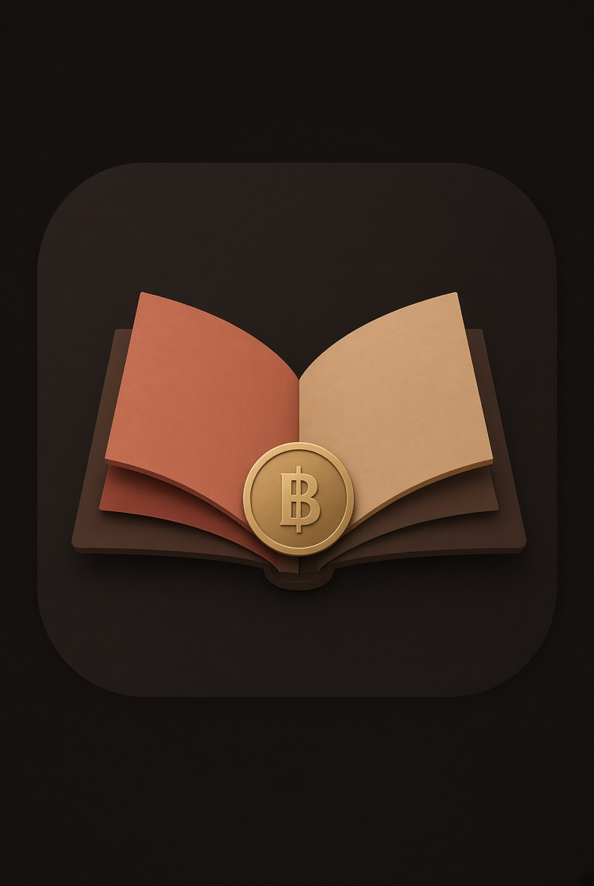
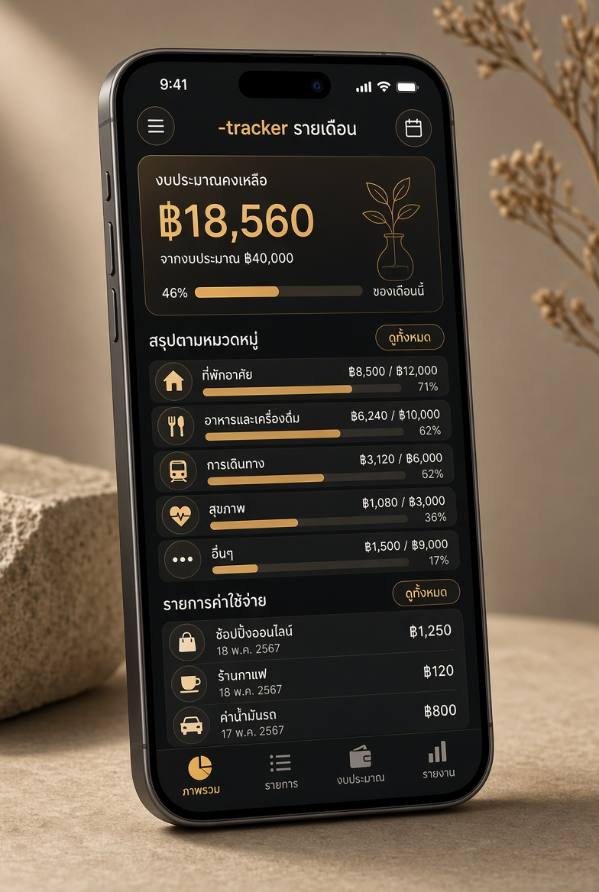
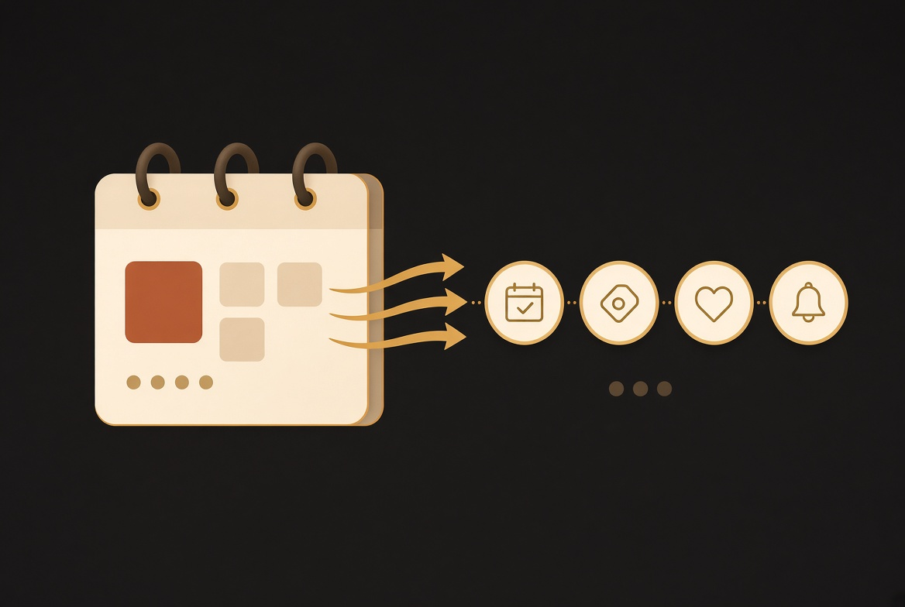

# สมุดเดือน

แอปบันทึกค่าใช้จ่ายรายเดือนภาษาไทย เก็บข้อมูลไว้ในเครื่อง (localStorage) ไม่ต้องสมัครสมาชิก

## ฟีเจอร์หลัก

- งบเดือนนี้ / เหลือเท่าไหร่ / แถบความคืบหน้า
- แยกตามหมวด (อาหาร เดินทาง ที่อยู่ ค่าบิล ช้อป สุขภาพ บันเทิง อื่นๆ)
- **รายการซ้ำทุกเดือน** (ผ่อน / subscription) โผล่ในเดือนถัดไปทันที ถ้าไม่ระบุจำนวนเดือนจะไปจนสิ้นปี
- **บัตรเครดิตและบัญชีธนาคาร** เป็น master (ชื่อ + เลข 4 ตัวท้าย) เลือกใช้ตอนบันทึกรายจ่าย
- ปุ่มบันทึกติดด้านล่างของแผ่นบันทึกเสมอ เลื่อนไม่หลุดจอ
- ข้อมูลตัวอย่างที่ล้างได้

## วิธีใช้

1. เปิด `index.html` ในเบราว์เซอร์ (หรืออัปโหลดขึ้นโฮสต์)
2. กด **บันทึก** ใส่ยอด เลือกหมวด วิธีจ่าย
3. ถ้าเป็นรายการซ้ำ เปิด **ซ้ำทุกเดือน** ใส่จำนวนเดือน หรือเว้นว่างจนสิ้นปี
4. เดือนถัดไปจะเห็นรายการทันที
5. แตะรายการเพื่อแก้หรือลบ (เฉพาะเดือนนี้ หรือทั้งชุด)

## วิธีโฮสต์

### GitHub Pages (แนะนำสำหรับอนาคต)
1. สร้าง repo ใหม่บน GitHub
2. อัปโหลดไฟล์ทั้งหมดในโฟลเดอร์นี้
3. Settings → Pages → Deploy from branch → main / root
4. ได้ลิงก์ `https://username.github.io/repo-name`

### Netlify / Cloudflare Pages
- ลากโฟลเดอร์นี้วางเข้าไปได้เลย ได้ลิงก์ทันที

### Google Drive
- อัปโหลด `index.html` แล้วแชร์เป็น “ทุกคนที่มีลิงก์” เปิดได้ แต่แก้แล้วต้องอัปโหลดทับทุกครั้ง ไม่สะดวกเท่าโฮสต์จริง

## ข้อมูล

เก็บไว้ใน localStorage ของเบราว์เซอร์เท่านั้น ไม่ได้ส่งออกไปไหน ถ้าล้างข้อมูลเบราว์เซอร์หรือเปลี่ยนเครื่อง ข้อมูลจะหาย (สำรองด้วยการส่งออก JSON ได้ในอนาคต)

---

สร้างด้วย Grok
